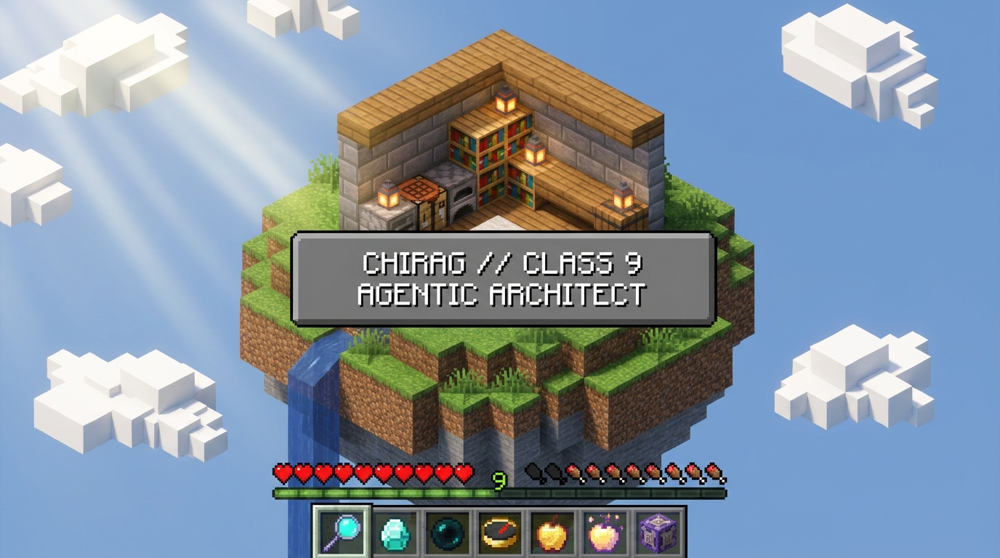
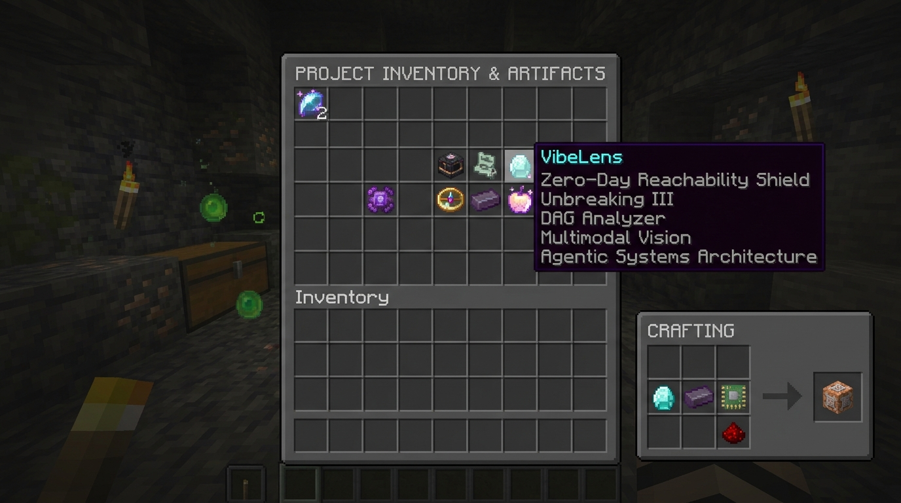
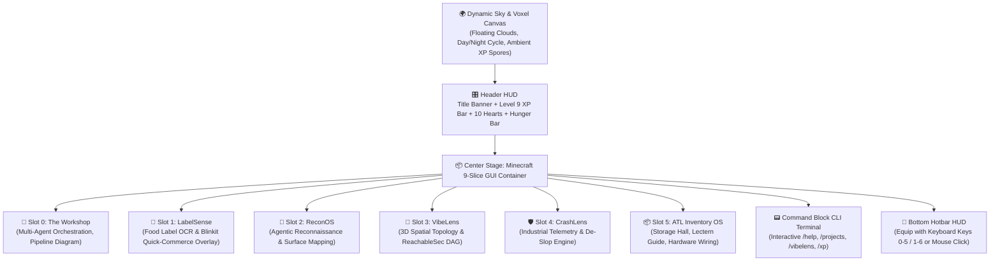

# 🎮 Minecraft Portfolio // Visual Layout & Concept Previews
**Creator:** Chirag (Class 9 Agentic Systems Architect & Engineer)  
**Theme:** Minecraft Survival & Creative GUI Interface (Pixel-art typography, Hotbar HUD, 9-Slice Dialogs, Enchantment Tooltips, Redstone CLI)

---

## 🖼️ Visual Concept Previews

````carousel

<!-- slide -->

````

---

## 🗺️ Architectural Flow & Layout Map



---

## 🧱 The 5 Core Layout Sections

### 1. Header & Player Status HUD
- **Title Banner**: `CHIRAG'S REALM` in 3D beveled Minecraft stone lettering with subtle gradient text shading.
- **Bouncing Splash Text**: Yellow angled text with authentic bouncy animation:
  - *"Now with 100% more Agentic Systems!"*
  - *"Crafting code in Class 9!"*
  - *"Silencing phantom security warnings!"*
  - *"Netherite Grade Clean Architecture!"*
- **Player Stats**:
  - `❤️❤️❤️❤️❤️❤️❤️❤️❤️❤️` (10 full pixel hearts)
  - `🍗🍗🍗🍗🍗🍗🍗🍗🍗🍗` (10 hunger drumsticks)
  - **Level 9 XP Bar**: Glowing neon green bar displaying **Level 9** (celebrating Class 9 achievement).
- **HUD Toggles**: Day/Night skybox transition ☀️/🌙 and retro Web Audio SFX mute button 🔊.

---

### 2. Main Inspection GUI (The Inventory Chest)
The center stage uses authentic Minecraft GUI styling (classic `#c6c6c6` gray, dark border `#373737`, 3D inner bevels, pixel typography):
- **Gamemode Tabs**:
  - `⛏️ Builds & Inventions` (Project Cards Grid)
  - `📜 Player Lore` (Bio & Attributes)
  - `🧪 Tech Alchemy` (Tech Stack & Tooling)
  - `🏆 Advancements` (Milestones & Awards)

---

### 3. Project Itemization & Lore Cards
Each signature project is mapped to an iconic Minecraft enchanted item:

| Slot | Project | Minecraft Item | Enchantment / Rarity | Core Capability & Architecture |
| :--- | :--- | :--- | :--- | :--- |
| **#0** | **The Workshop** | 🔨 Crafting Table & Beacon | **Epic (Purple) // Efficiency V** | Multi-agent orchestration, eval-driven execution loops, deterministic tool grounding. |
| **#1** | **LabelSense** | 🧪 Golden Apple | **Epic (Purple) // Efficiency V** | Multimodal AI food packaging scanner decoding cryptic additives into plain language, personalized health profile, Blinkit quick-commerce overlay. |
| **#2** | **ReconOS** | 🧭 Autonomous Compass | **Rare (Cyan) // Infinity I** | Autonomous reconnaissance OS deploying subagent swarms to map code attack surfaces and audit dependencies. |
| **#3** | **VibeLens** | 🔮 Eye of Ender | **Rare (Cyan) // Unbreaking III** | 3D Spatial Topology galaxy map, ReachableSec DAG callgraph analyzer (silences 85% phantom CVEs), and VibeWatcher CLI. |
| **#4** | **CrashLens** | 🛡️ Netherite Core | **Epic (Purple) // Protection IV** | Industrial-grade telemetry design standard; eliminates pastel AI slop, converts crash stacktraces into structured blueprints, circuit breakers. |
| **#5** | **ATL Inventory OS** | 📦 Chest & Lectern | **Rare (Cyan) // Mending I** | Storage hall with labelled chests, inventory system, interactive lectern guide answering wiring questions with animated pinouts and lab video. |

---

### 4. Interactive Command Block Terminal
At the bottom of the interface, an authentic Command Block terminal allows visitors to run commands:
- `/help` - Lists all executable commands.
- `/projects` - Swaps view to project item cards.
- `/vibelens`, `/crashlens`, `/reconos`, `/labelsense`, `/atlinventory`, `/workshop` - Opens deep-dive inspection modal for that project.
- `/xp` - Plays triumphant level-up chime and triggers celebratory XP advancement.
- `/time` - Flips the canvas sky between day and night.

---

### 5. Hotbar HUD & Audio Soundscape
- **Fixed Hotbar at Bottom**: Slots 1–6 (or 0–5). Keyboard numbers jump directly to buildings or equip items.
- **Dynamic Tooltips**: Hovering any slot displays Minecraft item rarity tooltips with glowing purple or cyan text.
- **Pure Web Audio Synthesizer**: Synthesizes wooden block clicks, hover pops, and resonant XP chime when an advancement is triggered.
